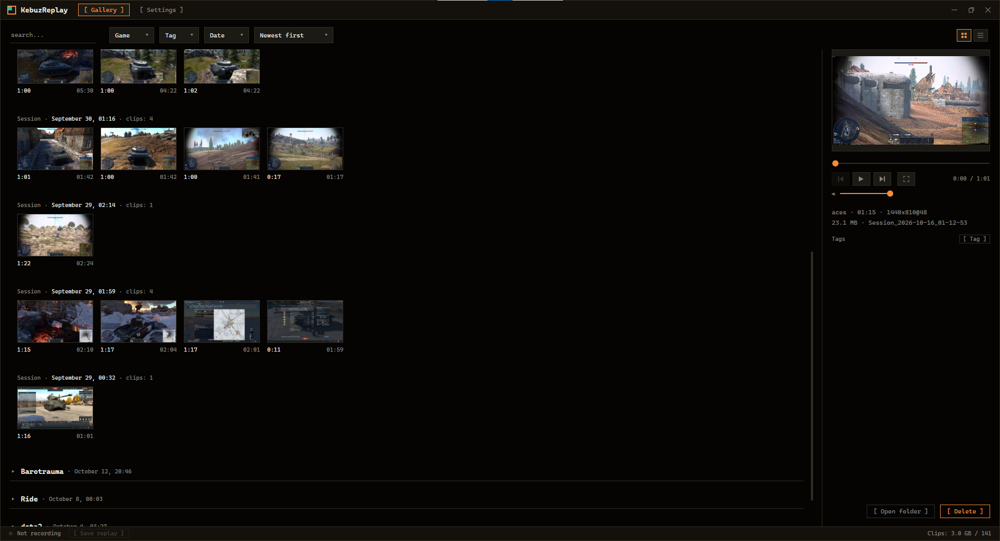
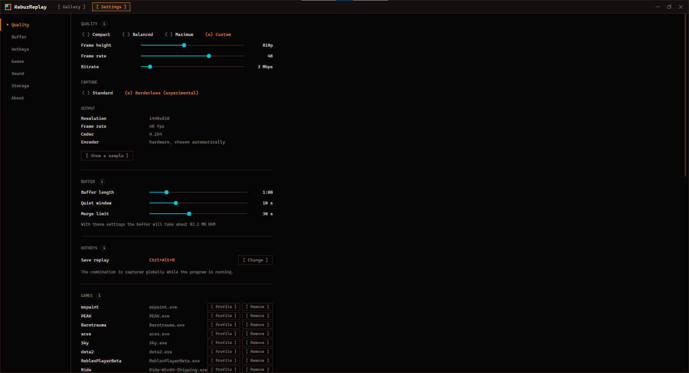

<div align="center">

# KebuzReplay

**Instant replay for Windows games that starts by itself.**
Launch a game and press nothing: recording is already running, one hotkey saves the last minutes as a clip.

[](#)
[](https://dotnet.microsoft.com/)
[](https://learn.microsoft.com/dotnet/desktop/wpf/)
[](LICENSE)

[English](README.md) | [Русский](README.ru.md)

</div>



---

## Why

A lighter and handier alternative to NVIDIA Instant Replay and the OBS Replay Buffer. No scenes, no sources, no button to remember before the moment happens: the game starts, the recording starts with it, and the moment worth keeping is saved after it happened.

The last minutes live in memory, compressed. Nothing touches the disk until you press the hotkey, so an evening of play does not write gigabytes you will never watch.

Fully private: no account, no cloud, no telemetry. The only network request is a check for a new version on GitHub, once a day, and it can be turned off in the settings. The microphone is off until you switch it on.

The interface is in English and Russian: it follows the Windows language and can be switched in the settings.

## What it does

### Records without being asked

Put a game on the list once, and every launch of it starts a recording session; quitting the game ends it. A new game is noticed by itself: an application that covers the whole screen and loads the graphics card, or a window started from a Steam, Epic or GOG folder, gets one quiet question - record it or not.

### One hotkey, one clip

`Ctrl+Alt+R` by default saves the last part of the buffer, from 15 seconds to 5 minutes, as an mp4 with sound. Pressed again a few seconds later, it extends the same clip instead of making a second overlapping one, so three replays in a row become one file. A toast with a thumbnail tells you it is saved; a click on it opens the clip.

### Hardware encoding

H.264 on the graphics card through Media Foundation, captured with Windows.Graphics.Capture. Three presets (compact 720p, balanced 810p, maximum at native resolution and 60 fps) or your own height, frame rate and bitrate. The settings show how much memory the buffer will take and how much a full clip weighs before you record anything.

### Sound the way you hear it

Either everything you hear, or only the applications you pick, the game among them. The microphone goes on top as its own source, with optional noise suppression. Every source has its own level up to 200% and a live meter, and a soft limiter keeps the mix from clipping.

### A gallery sorted by game and session

Clips are grouped by game and by play session; a game can be folded away. Tags with your own icon and colour, filters by tag and date, search, a fullscreen player. Trim a clip without re-encoding: keep the original and save a cut next to it, or replace it (the original goes to the recycle bin). Deleting goes to the recycle bin too, and tagged clips are never removed automatically, even when the folder size limit cleans up old ones.

### The rest

- **Per-game profiles** - quality, buffer, sound, hotkey and capture mode of their own for one game.
- **After the game exits** the recording goes on for a while with a black picture and sound, so the crash itself can still be saved; if the game comes back in that time, the recording just continues.
- **Which window is recorded** - a toast with a frame of it every time recording starts, and the same frame in the gallery status line.
- **No yellow frame on Windows 10** - an experimental capture mode that records through a hidden thumbnail window, so the capture border Windows 10 draws around the game does not appear.
- **It survives failures** - a supervisor restarts the recorder if it crashes, and capture comes back by itself after the graphics driver resets.



## Install

Grab a file from [Releases](../../releases):

| Download | What it is |
| --- | --- |
| `KebuzReplay-Setup-win-x64.exe` | **Recommended.** Installer, about 6 MB. Installs for your user only, no administrator rights; a Start menu shortcut, removal through *Apps*. Fetches the .NET 10 Desktop Runtime from Microsoft if you do not have it. |
| `KebuzReplay-win-x64-portable.zip` | Everything inside, nothing to install. Unpack anywhere and run. |
| `KebuzReplay-win-x64-lite.zip` | The same without the runtime, about 7 MB: needs the [.NET 10 Desktop Runtime](https://dotnet.microsoft.com/download/dotnet/10.0) installed. |

**Portable data.** Both archives contain a `KebuzReplay` folder with a `kebuz.portable` marker next to the executable. With the marker, everything the program remembers (settings, the game list, logs, thumbnails) lives in a `Data` folder inside that folder: move or back up the folder and it all goes along. To update, unpack the new archive over the old folder; `Data` is not in the archive and stays. Delete the marker and it behaves like an installed copy.

**Requirements.** Windows 10 version 2004 or newer, or Windows 11, x64, and a graphics card with a hardware H.264 encoder (NVIDIA, AMD or Intel). Recording only the chosen applications needs a Windows that supports per-process audio capture; the settings tell you if yours does not.

**SmartScreen.** The files are not signed yet, so Windows may warn on first start: *More info > Run anyway*. You can check a download against `checksums.txt`.

## Build from source

.NET 10 SDK required (the version is pinned in `global.json`).

```
dotnet build KebuzReplay.slnx
dotnet run --project Kebuz.App
```

Release files (installer, portable and lite archives, checksums) are built by `build\release.ps1`; it needs [Inno Setup 6](https://jrsoftware.org/isinfo.php).

## Where the data lives

| What | Where |
| --- | --- |
| Settings, the game list, the list of applications that are not games | `%APPDATA%\Kebuz\KebuzReplay` |
| Logs, thumbnails, a copy of the clip index | `%LOCALAPPDATA%\Kebuz\KebuzReplay` |
| All of the above, in the portable version | `Data\` next to the executable |
| Clips | `Videos\KebuzReplay\<game>\<session>\`, the folder can be changed in the settings |
| Tags and folded games | `kebuz-clips.json` in the clips folder |

## Layout

| Project | What is inside |
| --- | --- |
| `Kebuz.App` | The executable: a supervisor that starts the recorder and the interface as its own child processes and restarts the recorder if it fails. |
| `Kebuz.Recorder` | No UI at all: capture, encoding, the in-memory buffer, the hotkey, clip saving, sound, game detection. |
| `Kebuz.Gui` | The gallery and the settings, on WPF. |

The processes talk over named pipes. Everything native (Win32, COM, WinRT) goes through CsWin32; nothing outside the .NET runtime ships with the program.

## License

MIT, see [LICENSE](LICENSE).
