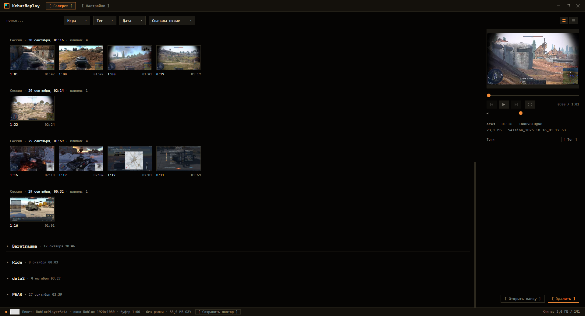
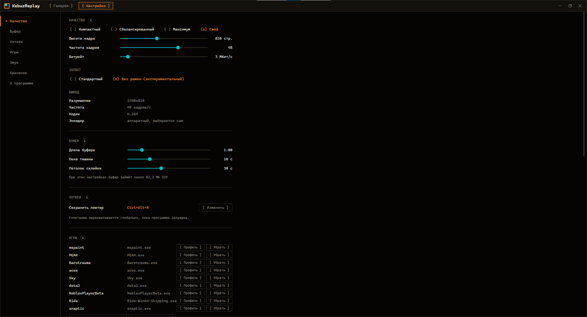

<div align="center">

# KebuzReplay

**Мгновенный повтор для игр на Windows, который включается сам.**
Запустите игру и ничего не нажимайте: запись уже идёт, один хоткей сохраняет последние минуты клипом.

[](#)
[](https://dotnet.microsoft.com/)
[](https://learn.microsoft.com/dotnet/desktop/wpf/)
[](LICENSE)

[English](README.md) | [Русский](README.ru.md)

</div>



---

## Зачем

Лёгкая и удобная замена NVIDIA Instant Replay и буферу повтора OBS. Ни сцен, ни источников, ни кнопки, которую надо не забыть нажать до того, как случится момент: игра запустилась - запись пошла вместе с ней, а то, что стоит оставить, сохраняется уже после того, как оно произошло.

Последние минуты живут в памяти в сжатом виде. На диск ничего не пишется, пока не нажат хоткей, так что вечер игры не оставляет гигабайты, которые никто не будет смотреть.

Полностью приватно: без аккаунта, без облака, без телеметрии. Единственный сетевой запрос - проверка новой версии на GitHub раз в сутки, и её можно выключить в настройках. Микрофон выключен, пока вы его не включите.

Интерфейс на русском и английском: язык берётся из Windows, его можно сменить в настройках.

## Что умеет

### Пишет без напоминаний

Добавьте игру в список один раз, и каждый её запуск начинает сессию записи, а выход из игры её заканчивает. Новую игру программа замечает сама: приложение на весь экран с нагрузкой на видеокарту или окно, запущенное из папки Steam, Epic или GOG, получает один тихий вопрос - записывать или нет.

### Один хоткей - один клип

`Ctrl+Alt+R` по умолчанию сохраняет последнюю часть буфера, от 15 секунд до 5 минут, в mp4 со звуком. Нажатие через несколько секунд продлевает тот же клип, а не создаёт второй с наложением, поэтому три повтора подряд дают один файл. Уведомление с миниатюрой сообщает, что клип сохранён, щелчок по нему открывает клип.

### Аппаратное кодирование

H.264 на видеокарте через Media Foundation, захват через Windows.Graphics.Capture. Три пресета (компактный 720p, сбалансированный 810p, максимум в родном разрешении и 60 кадрах) или своя высота, частота кадров и битрейт. Настройки заранее показывают, сколько памяти займёт буфер и сколько будет весить клип на всю его длину.

### Звук так, как вы его слышите

Либо всё, что слышно на компьютере, либо только выбранные приложения, игра в их числе. Микрофон идёт поверх отдельным источником, с шумоподавлением по желанию. У каждого источника свой уровень до 200% и живой индикатор, мягкий лимитер не даёт миксу перегружаться.

### Галерея по играм и сессиям

Клипы сгруппированы по играм и игровым сессиям, игру можно свернуть. Теги со своей иконкой и цветом, фильтры по тегам и датам, поиск, полноэкранный плеер. Обрезка без перекодирования: оставить оригинал и сохранить обрезок рядом или заменить его (оригинал уходит в корзину). Удаление тоже в корзину, а помеченные клипы не удаляются автоматически никогда, даже когда лимит папки чистит старые.

### Остальное

- **Профили игр** - своё качество, буфер, звук, хоткей и режим захвата для отдельной игры.
- **После выхода игры** запись ещё какое-то время идёт чёрным кадром со звуком, так что сам вылет можно сохранить; если игра за это время вернулась, запись просто продолжается.
- **Какое окно пишется** - уведомление с кадром этого окна при каждом старте записи и тот же кадр в строке состояния галереи.
- **Без жёлтой рамки на Windows 10** - экспериментальный режим захвата через скрытое окно с превью, при котором рамка, которую Windows 10 рисует вокруг игры, не появляется.
- **Переживает сбои** - супервизор перезапускает упавший рекордер, а захват сам возвращается после сброса драйвера видеокарты.



## Установка

Скачайте файл из [Releases](../../releases):

| Файл | Что это |
| --- | --- |
| `KebuzReplay-Setup-win-x64.exe` | **Рекомендуется.** Установщик, около 6 МБ. Ставит только для вашего пользователя, без прав администратора; ярлык в «Пуске», удаление через «Приложения». Сам скачает .NET 10 Desktop Runtime от Microsoft, если его нет. |
| `KebuzReplay-win-x64-portable.zip` | Всё внутри, ничего ставить не нужно. Распакуйте куда угодно и запустите. |
| `KebuzReplay-win-x64-lite.zip` | То же без среды выполнения, около 7 МБ: нужен установленный [.NET 10 Desktop Runtime](https://dotnet.microsoft.com/download/dotnet/10.0). |

**Данные переносной версии.** В обоих архивах папка `KebuzReplay` с меткой `kebuz.portable` рядом с exe. С меткой всё, что программа помнит (настройки, список игр, логи, миниатюры), лежит в папке `Data` внутри этой папки: перенесли или сохранили папку - всё переехало вместе с ней. Обновление: распакуйте новый архив поверх старой папки, `Data` в архиве нет, она остаётся. Удалите метку - и программа поведёт себя как установленная.

**Требования.** Windows 10 версии 2004 или новее либо Windows 11, x64, и видеокарта с аппаратным кодировщиком H.264 (NVIDIA, AMD или Intel). Запись звука только выбранных приложений требует Windows с поддержкой захвата звука отдельного процесса; если ваша не умеет, настройки об этом скажут.

**SmartScreen.** Файлы пока не подписаны, поэтому при первом запуске Windows может предупредить: *Подробнее > Выполнить в любом случае*. Скачанный файл можно сверить с `checksums.txt`.

## Сборка из исходников

Нужен .NET 10 SDK (версия закреплена в `global.json`).

```
dotnet build KebuzReplay.slnx
dotnet run --project Kebuz.App
```

Файлы релиза (установщик, архивы portable и lite, контрольные суммы) собирает `build\release.ps1`; ему нужен [Inno Setup 6](https://jrsoftware.org/isinfo.php).

## Где лежат данные

| Что | Где |
| --- | --- |
| Настройки, список игр, список приложений, которые не игры | `%APPDATA%\Kebuz\KebuzReplay` |
| Логи, миниатюры, копия индекса клипов | `%LOCALAPPDATA%\Kebuz\KebuzReplay` |
| Всё перечисленное в переносной версии | `Data\` рядом с exe |
| Клипы | `Видео\KebuzReplay\<игра>\<сессия>\`, папку можно сменить в настройках |
| Теги и свёрнутые игры | `kebuz-clips.json` в папке клипов |

## Устройство

| Проект | Что внутри |
| --- | --- |
| `Kebuz.App` | Исполняемый файл: супервизор, который запускает рекордер и интерфейс отдельными дочерними процессами и перезапускает рекордер, если тот упал. |
| `Kebuz.Recorder` | Без интерфейса: захват, кодирование, буфер в памяти, хоткей, сохранение клипов, звук, определение игр. |
| `Kebuz.Gui` | Галерея и настройки на WPF. |

Процессы общаются по именованным каналам. Всё нативное (Win32, COM, WinRT) идёт через CsWin32; ничего, кроме среды .NET, с программой не поставляется.

## Лицензия

MIT, см. [LICENSE](LICENSE).
